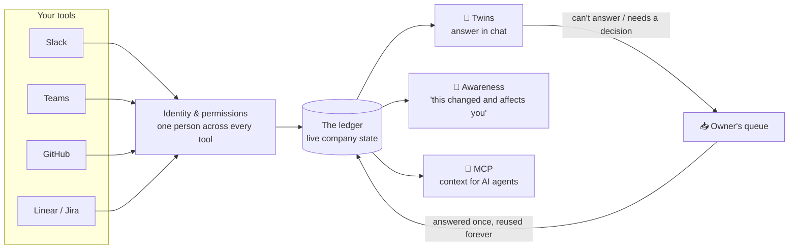

# Situation Awareness

**Your team's AI twins answer the quick questions, so your people don't have to stop what they're doing.**

An open-source, self-hosted system that keeps a live record of what your company has decided, promised and is blocked on. It gives every teammate an AI twin that answers for them, with sources, while they're busy.

> 🚧 **Early and honest about it:** we're in **phase M1 of 6**. The foundation works; the twin starts answering in M2. [See the roadmap](#roadmap). We're looking for **design partners** to shape it with us. [Work with us ↓](#work-with-us)

---

## Why we built this

Every company pays a hidden tax, and it grows with headcount:

> *"Hey, quick question…"*

Each one is small. Together they add up to your most knowledgeable people becoming **human routers**: interrupted all day, answering the same questions, while the work only they can do waits. Meanwhile everyone else waits on *them*.

Search tools didn't fix this. They tell you **where a document is**. They can't tell you **what's true right now**, and they can't answer for the person you're waiting on.

We wanted something that does.

## Sound familiar?

| The pain | What Situation Awareness does (by Release 0) |
|---|---|
| 🔁 **The quick-question tax.** Your senior people get pinged all day for answers they've given before. | Their twin answers instantly from what they've already said, shipped and decided. They're only pinged when it truly needs them. |
| ⏳ **Waiting on one person.** Work stalls for hours because only Priya knows, and she's heads-down. | Priya's twin answers now, with sources, and tells you how old the information is. You never wait for something that's already known. |
| 🗓️ **Status meetings that exist to find out what's going on.** | The current state of every workstream is always one question away, in the chat you already use. |
| 🌀 **Decisions evaporate.** "Didn't we already decide this?" Same debate, third time. | Decisions are captured in the thread, confirmed with one ✅, and become the record. Settled stays settled. |
| 🤝 **Promises get lost.** "I'll have it by Friday" disappears into a thread. | Commitments are tracked with an owner and a date, without anyone filling in a form. |
| 🚧 **Hidden blockers.** Team B is blocked on team A, and team A doesn't know. | Blockers are linked to the work they block. Owners and dependents get a heads-up when something changes. |
| 🧭 **New hires are lost for weeks** figuring out who knows what. | They ask, and the right person's twin answers, from day one. |
| 🚪 **Knowledge walks out the door** with vacations, sick days and departures. | The twin keeps answering from the record while someone is out, and clearly says so when they've left. |
| 🧩 **Tool sprawl.** Slack *and* Teams, GitHub *and* Linear. Nobody has the whole picture. | One live record across all of them. A decision confirmed in Teams answers a question asked in Slack. |
| 🕰️ **Stale answers.** Search finds a six-month-old thread about infrastructure that no longer exists. | Every answer shows its source and its age. Newer facts replace old ones; old ones are kept as history, not served as truth. |
| 🤖 **AI agents start every task blind.** Claude Code and similar tools don't know your company. | The same record is available to your agents over MCP, so they start with context instead of guessing. |
| 😬 **AI assistants feel risky.** They overshare, read too much, or speak for people wrongly. | Built the other way round. See [why it's safe to say yes](#why-its-safe-to-say-yes). |

## What it looks like

Priya is on *Do Not Disturb*, fixing the database. Sam asks in `#infra`:

```
Sam:          @Priya is the Postgres 16 migration done?

Priya's twin: Not yet. INFRA-123 is In Review (PR #812, updated 3h ago).
              Decided Oct 9: prod cutover is Friday Oct 16, 22:00 UTC.
              🤖 Priya's twin · sources: INFRA-123, PR #812, #infra thread · [ping Priya anyway]

Sam:          can we push the cutover to Monday?

Priya's twin: That's Priya's call, so I've put it in her queue. She'll see it at her next break.
```

Priya answers once, between tasks. Her answer becomes a fact her twin can reuse, so **nobody has to ask her that question again**.

## Why it's safe to say yes

We built this for the person who has to defend the decision to their security team, their legal team and their employees.

- **🏠 Self-hosted.** It runs on your infrastructure, and your data never leaves it. Open source (MIT), so you can read every line.
- **🔐 Permissions enforced in code, not by the AI.** An answer can only use what **both** the person asking **and** the twin's owner are allowed to see. That filter runs before the AI sees anything.
- **🙋 Opt-in, per person.** Nobody gets a twin they didn't ask for. Twins read public channels, tickets and code only. **No DMs, no email.**
- **👀 Fully transparent to the owner.** You see every question your twin was asked, by whom, and what it answered.
- **✋ It never commits on your behalf.** Facts and how-tos are answered instantly. Opinions come back clearly labelled as a *likely view*. Decisions and commitments always go to the human.
- **📎 Every answer shows its sources and age,** plus a one-click "ping them anyway".
- **🧾 A record, not surveillance.** We don't archive your chat. The system proposes decisions and commitments in the thread, and **people confirm them**. Only confirmed state is kept.
- **🔌 No lock-in.** Slack first, Teams next (M4), and designed to plug into other chat tools.

## How it works



**The ledger** is what everything else reads from. It holds a few simple things:

| Object | Example |
|---|---|
| **Person** | Priya Shah: the same human across Slack, Teams, GitHub and Linear |
| **Workstream** | INFRA-123 *Migrate primary DB to Postgres 16*, anchored on a real ticket, PR or channel |
| **Decision** | "Prod cutover Friday Oct 16, 22:00 UTC" (who, when, where it was said) |
| **Commitment** | "Rotate DB credentials by Oct 19" (owner, due date) |
| **Blocker** | "Stripe upgrade blocked on INFRA-123" (who's waiting on whom) |
| **Fact** | An answer the owner gave once, reused for every future asker |

Under the hood: Python and a single Postgres database (pgvector for search). Claude by default, or any OpenAI-compatible model, including fully local ones.

## Roadmap

| Phase | What it delivers | Status |
|---|---|---|
| **M1: Foundation** | The ledger, GitHub and Linear sync, Slack connection, one identity per person across tools, permission rules, and a test company with graded scenarios | ✅ **Built.** Next step: first real-workspace run |
| **M2: The twin answers** | Instant answers with sources, risk tiers, the owner's queue, and answers that become reusable facts | ⏭️ Next |
| **M3: The record writes itself** | Decisions, commitments and blockers proposed in-thread and confirmed with one ✅ | Planned |
| **M4: Microsoft Teams** | Everything above, in Teams | Planned |
| **M5: Awareness + agents** | "This changed and affects you" alerts, an MCP server for AI agents, and an owner page with controls and the question log | Planned |
| **M6: Ready for anyone** | One-command install, Slack and Teams app manifests, a data-processing document and a demo company | Planned |

## Work with us

We're looking for a small number of **design partners**: teams of roughly **50–500 people** on **Slack or Teams** plus **GitHub and Linear or Jira**, who feel the pain above.

What that means in practice:
- **Free setup for the first 2 companies.** We install it for you, on your infrastructure.
- **We tune it on your real workflows** and measure what it saves.
- **You shape the roadmap.** Your problems become our next phase.

📬 **Get in touch:** `esh` at `plan2ace.com` (written this way to keep spam bots out)

## Try it (developers)

```bash
brew install postgresql@17 && brew services start postgresql@17 && createdb sa
uv sync
uv run python -m sa seed     # load "Acme", a realistic 30-person test company
uv run python -m sa status   # see its workstreams
uv run python -m sa link     # review accounts that couldn't be matched automatically
createdb sa_test && DATABASE_URL=postgresql:///sa_test uv run python -m sa eval   # graded scenarios
```

With real data:

```bash
LINEAR_API_KEY=... GITHUB_TOKEN=... uv run python -m sa sync your-org/your-repo
SLACK_BOT_TOKEN=xoxb-... SLACK_APP_TOKEN=xapp-... uv run python -m sa slack   # app from slack-manifest.yaml
```

## License

MIT
